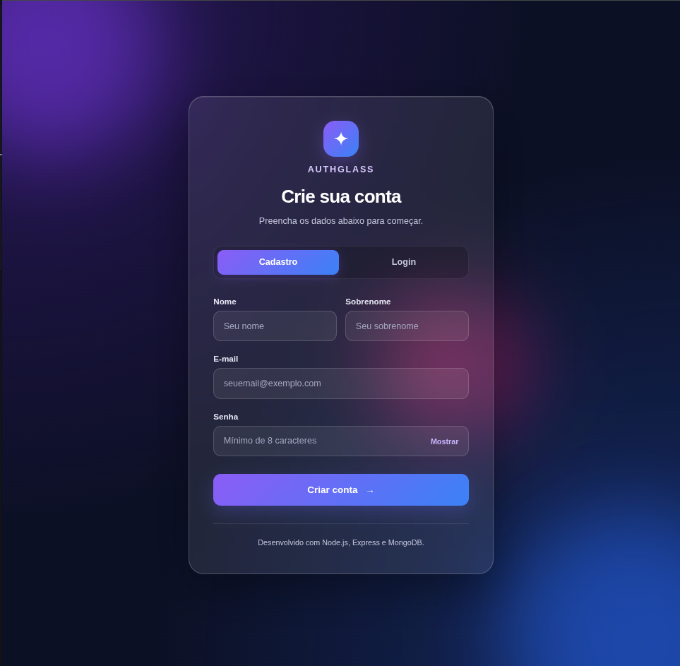

# ✨ AuthGlass

### Sistema de Cadastro e Login com Node.js, Express e MongoDB

O **AuthGlass** é uma aplicação web full-stack desenvolvida para realizar o cadastro de usuários e a verificação de credenciais, integrando uma interface moderna com um servidor Node.js e um banco de dados MongoDB.

O projeto utiliza o conceito visual **Glassmorphism**, com transparências, gradientes, efeitos de vidro fosco e layout responsivo.

Foi desenvolvido para fins educacionais, com foco no aprendizado de desenvolvimento web, APIs HTTP, persistência de dados e segurança básica de senhas.

---

## 🖥️ Interface

A aplicação apresenta uma interface com:

- Design Glassmorphism.
- Gradientes em tons de azul e roxo.
- Cartão translúcido com efeito de vidro.
- Alternância entre Cadastro e Login.
- Campos de formulário estilizados.
- Opção para mostrar ou ocultar senhas.
- Mensagens de sucesso e erro sem recarregar a página.
- Responsividade para computadores, tablets e celulares.

### Prévia do projeto

Adicione uma captura de tela na pasta `docs/` com o nome `authglass.png`.

Depois, utilize esta referência no README:



---

## 🚀 Tecnologias utilizadas

### Front-end

| Tecnologia | Utilização |
|---|---|
| HTML5 | Estrutura dos formulários |
| CSS3 | Estilização e responsividade |
| JavaScript | Interatividade da interface |
| Fetch API | Comunicação assíncrona com o servidor |

### Back-end

| Tecnologia | Utilização |
|---|---|
| Node.js | Ambiente de execução JavaScript |
| Express.js | Servidor HTTP e rotas |
| Mongoose | Modelagem e integração com MongoDB |
| bcryptjs | Hash e verificação de senhas |
| dotenv | Carregamento de variáveis de ambiente |

### Banco de dados e ferramentas

| Ferramenta | Utilização |
|---|---|
| MongoDB | Armazenamento dos usuários |
| Podman | Execução do MongoDB em contêiner |
| Thunder Client | Testes de requisições HTTP |
| Git | Controle de versão |
| GitHub | Hospedagem do repositório |

---

## ⚙️ Funcionalidades

### Cadastro de usuários

O sistema permite cadastrar usuários informando:

- Nome
- Sobrenome
- E-mail
- Senha

Durante o cadastro, são realizadas validações dos campos obrigatórios, formato do e-mail e tamanho da senha.

Os e-mails são normalizados para letras minúsculas, evitando inconsistências durante as consultas.

O sistema também impede o cadastro de e-mails duplicados.

### Proteção das senhas

As senhas não são armazenadas diretamente no banco de dados.

Antes do cadastro, o servidor utiliza `bcrypt.hash()` para gerar um hash da senha.

Na autenticação, utiliza `bcrypt.compare()` para verificar se a senha informada corresponde ao hash armazenado.

### Verificação de credenciais

O login permite informar e-mail e senha.

O servidor consulta o MongoDB e verifica as credenciais, retornando uma resposta de sucesso ou erro.

**Importante:** a implementação atual verifica as credenciais, mas não cria sessões autenticadas nem tokens JWT.

### Interface dinâmica

O JavaScript utiliza `fetch()` para enviar os formulários sem recarregar a página.

As respostas do servidor são apresentadas diretamente na interface Glassmorphism.

## 🖥️ Interface


---

## 📁 Estrutura do projeto

```text
cadastro/
├── models/
│   └── usuario.js
│
├── public/
│   ├── index.html
│   ├── style.css
│   └── script.js
│
├── docs/
│   └── authglass.png
│
├── .env
├── .env.example
├── .gitignore
├── package.json
├── package-lock.json
├── server.js
└── README.md
```

**Observação:** a pasta `docs/` e o arquivo `.env.example` devem ser criados caso ainda não existam. O arquivo `.env` é local e não deve ser enviado ao repositório.

---

## 📋 Pré-requisitos

Antes de executar o projeto, é necessário ter instalado:

- Node.js e npm
- Git
- MongoDB ou Podman com um contêiner MongoDB configurado

---

## 🛠️ Instalação e execução

### 1. Clonar o repositório

```bash
git clone https://github.com/NotFelBro/cadastro.git
```

Acesse a pasta:

```bash
cd cadastro
```

### 2. Instalar as dependências

```bash
npm install
```

As dependências utilizadas são:

- `express`
- `mongoose`
- `bcryptjs`
- `dotenv`

### 3. Configurar variáveis de ambiente

Crie um arquivo `.env` na raiz do projeto.

Caso exista um arquivo `.env.example`, utilize:

```bash
cp .env.example .env
```

Exemplo de configuração:

```dotenv
MONGO_URI=mongodb://127.0.0.1:27017/aula_usuarios
PORT=4000
```

| Variável | Descrição |
|---|---|
| `MONGO_URI` | Endereço de conexão com o MongoDB |
| `PORT` | Porta utilizada pelo Express |

O arquivo `.env` deve permanecer fora do controle de versão.

### 4. Iniciar o MongoDB

Se você já possui um contêiner Podman chamado `mongo-local`, execute:

```bash
sudo podman start mongo-local
```

Verifique se está funcionando:

```bash
sudo podman ps
```

O MongoDB precisa estar acessível pela porta `27017` do computador.

### 5. Iniciar o servidor

Execute:

```bash
node server.js
```

Caso o `package.json` tenha um script `start` configurado, também é possível utilizar:

```bash
npm start
```

Com a conexão estabelecida, o terminal exibirá:

```text
MongoDB conectado!
Servidor rodando em http://localhost:4000
```

### 6. Acessar a aplicação

Abra o navegador:

http://localhost:4000

---

## 🔌 Documentação dos endpoints

A API possui duas rotas principais.

### POST `/cadastro`

Responsável pelo cadastro de usuários.

**Content-Type:** `application/x-www-form-urlencoded`

| Campo | Tipo | Obrigatório |
|---|---|---|
| `nome` | String | Sim |
| `sobrenome` | String | Sim |
| `email` | String | Sim |
| `senha` | String | Sim |

**Respostas HTTP:**

| Status | Descrição |
|---|---|
| `201 Created` | Usuário cadastrado com sucesso |
| `400 Bad Request` | Dados inválidos |
| `409 Conflict` | E-mail já cadastrado |
| `500 Internal Server Error` | Erro interno do servidor |

### POST `/login`

Responsável pela verificação das credenciais.

**Content-Type:** `application/x-www-form-urlencoded`

| Campo | Tipo | Obrigatório |
|---|---|---|
| `email` | String | Sim |
| `senha` | String | Sim |

**Respostas HTTP:**

| Status | Descrição |
|---|---|
| `200 OK` | Credenciais corretas |
| `400 Bad Request` | Dados inválidos |
| `401 Unauthorized` | E-mail ou senha incorretos |
| `500 Internal Server Error` | Erro interno do servidor |

---

## 🧪 Testes realizados

As rotas foram verificadas utilizando o Thunder Client, no Visual Studio Code.

| Cenário | Status esperado | Resultado |
|---|---|---|
| Cadastro válido | `201` | Aprovado |
| Dados inválidos | `400` | Aprovado |
| E-mail duplicado | `409` | Aprovado |
| Login válido | `200` | Aprovado |
| Senha incorreta | `401` | Aprovado |
| E-mail inexistente | `401` | Aprovado |
| Persistência após reinicialização | Usuário permanece cadastrado | Aprovado |

Também foram realizados testes de funcionamento da interface e de responsividade.

---

## 🔐 Segurança

O projeto utiliza algumas práticas básicas de segurança:

- Armazenamento de senhas com hash bcrypt.
- Validação dos dados recebidos pelo servidor.
- Normalização de e-mails.
- Restrição de e-mails duplicados.
- Uso de `select: false` para evitar a inclusão automática do hash nas consultas comuns do Mongoose.
- Utilização de variáveis de ambiente.
- Arquivo `.env` ignorado pelo Git.
- Mensagem genérica para credenciais incorretas.

### Limitações

O projeto é uma aplicação educacional e ainda não possui todos os mecanismos necessários para uso em produção.

Entre as funcionalidades não implementadas estão:

- Sessões autenticadas.
- Tokens JWT.
- Recuperação de senha.
- Confirmação de e-mail.
- Limitação de tentativas de login.
- Testes automatizados.

---

## 📈 Melhorias futuras

- Implementar autenticação com sessões seguras.
- Criar uma área autenticada para usuários.
- Adicionar recuperação de senha.
- Implementar testes automatizados.
- Melhorar a acessibilidade.
- Preparar a aplicação para implantação.

---

## 📄 Licença

Este projeto utiliza a licença ISC, conforme declarada no `package.json`.

---

## 👨‍💻 Desenvolvimento

Projeto desenvolvido como atividade prática de aprendizagem em desenvolvimento web full-stack.

**Repositório:** [NotFelBro/cadastro](https://github.com/NotFelBro/cadastro)

---

**AuthGlass — Integração entre interface moderna, API HTTP e persistência de dados.**